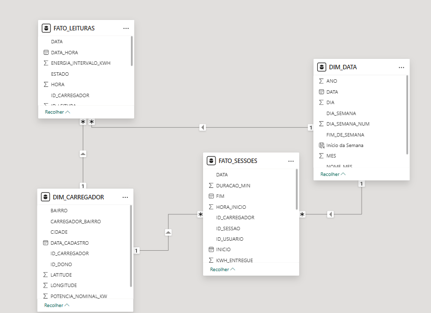

# ultima-gs · Big Data e visualização

Global Solution 2026/2 · CitizenTech

## Ideia do projeto

Plataforma para **donos de carregadores de carro elétrico compartilharem o carregador** com outros
motoristas e serem pagos por isso. O motorista paga pelo app e o carregador entrega a energia
equivalente ao valor pago.

Cada carregador tem um **sistema embarcado** (Arduino/Tinkercad) que mede a energia entregue, corta a
carga quando o valor pago é atingido e **reduz ou pausa a carga se o conector superaquecer**.

**Nesta área**, os dados gerados pelos carregadores são organizados e transformados em indicadores para:

- **o dono:** acompanhar faturamento e horários de maior uso;
- **a plataforma:** identificar carregadores com superaquecimento que precisam de manutenção.

# Uso de IA generativa

| Ferramenta | Para quê |
|---|---|
| **Claude** (Anthropic) | apoio no desenvolvimento e na documentação desta área |

**Como foi usada:**

- **Explicação de conceitos:** camadas de dados (RAW, STG, INT, FINAL), stage e `COPY INTO` no Snowflake,
  dbt (macros, models, testes), modelo estrela e medidas DAX.
- **Geração e revisão de código:** script dos dados simulados, script de setup do Snowflake, macros e
  models do dbt e medidas DAX do Power BI.
- **Apoio no dashboard:** sugestões de visuais, layout e formatação.
- **Documentação:** estrutura e revisão do texto deste README.

**Revisão e validação:** o projeto foi construído etapa por etapa. Cada parte do código foi explicada,
revisada e executada pelo aluno no Snowflake, no dbt e no Power BI, e os resultados foram conferidos
(contagem de linhas, testes do dbt e valores do dashboard) antes de seguir para a etapa seguinte.


## Origem dos dados

Os dados são **simulados (mock)**, pois o Tinkercad não se conecta à internet. Eles seguem **a mesma
lógica do código do Arduino**. Na solução real, viriam dos carregadores pela internet.

| Arquivo | Conteúdo | Linhas |
|---|---|---|
| `csv/leituras_carregador.csv` | 1 linha por ciclo do carregador: temperatura, estado, potência e energia entregue | 20.000 |
| `csv/carregadores.csv` | cadastro dos carregadores: bairro, dono, tarifa e potência | 8 |


## Colunas

### `leituras_carregador.csv` (1 linha por ciclo do carregador)

| Coluna | Descrição |
|---|---|
| `id_leitura` | identificador único da leitura |
| `id_sessao` | sessão de carga (do pagamento até o fim da carga) |
| `id_carregador` | carregador que gerou a leitura |
| `id_usuario` | motorista que pagou pela carga |
| `data_hora` | momento da leitura (cada ciclo = 6 min de carga simulados) |
| `volta` | número do ciclo dentro da sessão (0 = momento do pagamento) |
| `intervalo_ms` | tempo real desde a leitura anterior, em milissegundos |
| `valor_pago_brl` | valor pago no app (R$); repete em todas as leituras da sessão |
| `tarifa_kwh_brl` | preço do kWh definido pelo dono (R$) |
| `kwh_pago` | energia comprada: valor pago ÷ tarifa |
| `leitura_pot_adc` | valor bruto do sensor de potência (0 a 1023) |
| `leitura_temp_adc` | valor bruto do sensor de temperatura (0 a 1023) |
| `temperatura_c` | temperatura do conector em °C |
| `estado` | proteção térmica: `NORMAL`, `REDUZIDO` ou `PAUSADO` |
| `potencia_pedida_kw` | potência que o carro está puxando (kW) |
| `potencia_entregue_kw` | potência entregue após a proteção térmica (100%, 50% ou 0) |
| `energia_intervalo_kwh` | energia entregue neste ciclo: potência × tempo |
| `kwh_entregue` | energia acumulada na sessão até esta leitura |
| `led_status` | LED aceso: `VERDE`, `AMARELO` ou `VERMELHO` |
| `rele` | `LIGADO` (energia liberada) ou `DESLIGADO` (energia cortada) |
| `carga_concluida` | `true` na leitura em que a energia paga foi atingida |

### `carregadores.csv` (1 linha por carregador)

| Coluna | Descrição |
|---|---|
| `id_carregador` | identificador do carregador |
| `id_dono` | dono do carregador (um dono pode ter mais de um) |
| `bairro` / `cidade` | localização do carregador |
| `latitude` / `longitude` | coordenadas aproximadas (para mapa) |
| `potencia_nominal_kw` | potência máxima do carregador (7,4 ou 3,7 kW) |
| `tarifa_kwh_brl` | preço do kWh cobrado pelo dono (R$) |
| `data_cadastro` | data em que o carregador entrou na plataforma |

# Caminho do dado

## CSV → Stage

Primeira etapa da ingestão: os CSVs são enviados do computador para o **stage** `ULTIMA_GS.RAW.STAGE_IOT`,
uma área de arquivos dentro do Snowflake que funciona como "caixa de entrada". Isso simula o carregador
enviando seus dados para a nuvem.

O envio é feito pela macro dbt [`subir_arquivos_stage`](dbt_ultima_gs/macros/subir_arquivos_stage.sql),
que executa um `PUT` para cada arquivo da pasta `csv/`. Os arquivos são compactados (`.gz`) e, se já
existirem no stage, substituídos.

**Como funciona no código:**

```sql
put 'file://../csv/leituras_carregador.csv' @ultima_gs.raw.stage_iot
    auto_compress = true   -- compacta em .gz antes de enviar
    overwrite     = true   -- substitui o arquivo se ele já estiver no stage
```

- Um `for` do Jinja percorre a lista de arquivos e executa um `PUT` para cada um com `run_query`.
- A pasta vem da variável `pasta_dados` do `dbt_project.yml` (`../csv`).
- O status de cada envio (`UPLOADED` ou `SKIPPED`) é exibido no terminal com `log`.

```powershell
cd dbt_ultima_gs
dbt run-operation subir_arquivos_stage
```

Para conferir no Snowflake: `list @ultima_gs.raw.stage_iot;`

> Nesta etapa os dados ainda **não estão em tabelas**: apenas os arquivos chegaram ao stage.

## Stage → Source

Segunda etapa da ingestão: os arquivos do stage são carregados nas tabelas da camada **RAW**
(`RAW.LEITURAS_CARREGADOR` e `RAW.CARREGADORES`). Elas são a **source** do dbt, ou seja, o ponto de
partida das transformações.

A carga é feita pela macro [`copiar_stage_para_raw`](dbt_ultima_gs/macros/copiar_stage_para_raw.sql),
que executa um `COPY INTO` para cada tabela. Os dados entram **exatamente como estão no CSV** (tudo
como texto) e cada linha recebe duas colunas de auditoria:

| Coluna | Conteúdo |
|---|---|
| `_arquivo` | arquivo de origem da linha |
| `_carregado_em` | data e hora da carga |

**Como funciona no código:**

```sql
copy into ultima_gs.raw.leituras_carregador
from (
    select $1, $2, ..., $21,     -- colunas do CSV pela posição
           metadata$filename,    -- vai para _arquivo
           current_timestamp()   -- vai para _carregado_em
    from @ultima_gs.raw.stage_iot
)
file_format = (format_name = 'ultima_gs.raw.ff_csv')   -- vírgula, cabeçalho, UTF-8
pattern     = '.*leituras_carregador.*'                -- só o arquivo desta tabela
```

- `$1 … $21` leem as colunas do CSV na ordem em que aparecem; a tabela RAW tem as mesmas colunas, na mesma ordem.
- `pattern` separa os arquivos, já que os dois estão no mesmo stage.
- O resultado de cada carga (arquivo, status e linhas carregadas) é exibido no terminal.

```powershell
cd dbt_ultima_gs
dbt run-operation copiar_stage_para_raw
```

> O Snowflake registra os arquivos já carregados: executar de novo com os mesmos arquivos **não duplica** os dados.

## Source → STG

Primeira camada de transformação, feita com **models do dbt** em
[`models/staging`](dbt_ultima_gs/models/staging). Os models leem as tabelas RAW (source) e criam
**views** no schema `STG`:

| Model | Origem | Conteúdo |
|---|---|---|
| `stg_leituras` | `RAW.LEITURAS_CARREGADOR` | leituras dos carregadores |
| `stg_carregadores` | `RAW.CARREGADORES` | cadastro dos carregadores |

O que muda em relação à RAW:

- **Tipos corretos:** texto vira número, data ou verdadeiro/falso. As funções `try_` transformam
  valores inválidos em nulo em vez de interromper o processamento.
- **Padronização:** espaços removidos e textos em maiúsculas; `rele` vira `rele_ligado` (verdadeiro/falso).
- **Sem duplicidade:** se a mesma linha for carregada mais de uma vez, fica só a carga mais recente.
- **Testes:** `unique` e `not_null` garantem que cada leitura e cada carregador aparecem uma única vez.

**Como funciona no código** (`stg_leituras`):

```sql
select
    try_to_number(id_leitura)                                 as id_leitura,
    try_to_timestamp_ntz(data_hora, 'YYYY-MM-DD HH24:MI:SS')  as data_hora,
    try_to_decimal(temperatura_c, 5, 1)                       as temperatura_c,
    upper(trim(estado))                                       as estado,
    upper(trim(rele)) = 'LIGADO'                              as rele_ligado,
    ...
from {{ source('raw', 'leituras_carregador') }}
qualify row_number() over (partition by id_leitura order by _carregado_em desc) = 1
```

- `source()` aponta para a tabela RAW declarada em `_sources.yml`; é assim que o dbt monta a linhagem do dado.
- `qualify row_number() ... = 1` numera as cópias de cada leitura, da carga mais recente para a mais antiga, e mantém só a primeira.
- O schema `STG` vem do `dbt_project.yml` (`+schema: stg`). A macro `generate_schema_name` faz o dbt usar esse nome exato, em vez de `RAW_STG`.

```powershell
cd dbt_ultima_gs
dbt build --select staging
```

## STG → INT

Camada de **regras de negócio**, em [`models/intermediate`](dbt_ultima_gs/models/intermediate). O model
`int_sessoes` agrupa as leituras da `stg_leituras` e gera **uma linha por sessão de carga** (view no schema `INT`).

**Por que é necessário:** cada carga tem cerca de 50 leituras, e o valor pago se repete em todas.
Somar a receita direto nas leituras multiplicaria o valor. Agrupando por sessão, cada carga é contada uma vez.

| Coluna | Regra |
|---|---|
| `inicio` / `fim` / `duracao_min` | primeira e última leitura; duração em minutos de carga simulados |
| `valor_pago_brl` | valor da sessão, contado uma única vez |
| `kwh_pago` / `kwh_entregue` | energia comprada e energia efetivamente entregue |
| `minutos_normal` / `minutos_reduzido` / `minutos_pausado` | tempo da carga em cada estado da proteção térmica |
| `pct_tempo_alerta` | fração do tempo em REDUZIDO ou PAUSADO (0 a 1) |
| `qtd_pausas` | quantas vezes a carga **entrou** em PAUSADO (eventos de superaquecimento) |
| `temperatura_max_c` / `temperatura_media_c` | temperatura máxima e média do conector na carga |
| `kwh_excedente` | energia entregue além da paga (o último ciclo passa um pouco do limite) |
| `status_sessao` | `CONCLUIDA` ou `EM_ANDAMENTO` |

**Como funciona no código:** o model é dividido em 3 etapas (CTEs).

```sql
-- 1. prepara cada leitura: marca quando a carga ENTRA em pausa
iff(estado = 'PAUSADO'
    and coalesce(lag(estado) over (partition by id_sessao order by volta), '') <> 'PAUSADO',
    1, 0) as inicio_pausa

-- 2. agrupa as leituras em sessões
select id_sessao,
       any_value(valor_pago_brl)                            as valor_pago_brl,  -- uma vez por sessão
       sum(iff(estado = 'REDUZIDO', minutos_intervalo, 0))  as minutos_reduzido,
       sum(inicio_pausa)                                    as qtd_pausas
from leituras_preparadas
group by id_sessao

-- 3. métricas derivadas
div0(minutos_reduzido + minutos_pausado, duracao_min) as pct_tempo_alerta
```

- `minutos_intervalo = intervalo_ms × 360 ÷ 60.000` converte o tempo real em minutos de carga simulados (variável `aceleracao`).
- `lag()` olha a leitura anterior da mesma sessão: 3 leituras seguidas em PAUSADO contam como **1** pausa.
- `div0` evita erro de divisão por zero.
- `ref('stg_leituras')` cria a dependência: o dbt sempre executa a STG antes da INT.

```powershell
cd dbt_ultima_gs
dbt build --select intermediate
```

## INT → FINAL

Camada consumida pelo **Power BI**, em [`models/final`](dbt_ultima_gs/models/final). Os dados são
organizados em **tabelas fato e dimensão** (modelo estrela), criadas como **tabelas** no schema `FINAL`
para o dashboard consultar mais rápido.

| Tabela | Tipo | 1 linha por | Uso no dashboard |
|---|---|---|---|
| `fato_sessoes` | fato | carga | receita, ticket médio, duração, pausas e tempo em alerta |
| `fato_leituras` | fato | ciclo do carregador | temperatura e estado ao longo do tempo |
| `dim_carregador` | dimensão | carregador | filtros por carregador, bairro e dono |
| `dim_data` | dimensão | dia | filtros por dia, semana e mês; funções de tempo no DAX |



| Relacionamento | Cardinalidade | Coluna |
|---|---|---|
| `dim_data` → `fato_sessoes` | 1 → * | `data` |
| `dim_data` → `fato_leituras` | 1 → * | `data` |
| `dim_carregador` → `fato_sessoes` | 1 → * | `id_carregador` |
| `dim_carregador` → `fato_leituras` | 1 → * | `id_carregador` |

As dimensões filtram as fatos em **direção única**, e **não há relacionamento entre as duas fatos**:
assim cada filtro chega às tabelas por um único caminho, sem ambiguidade.

- O **valor pago fica só na `fato_sessoes`**. Na `fato_leituras` ele se repetiria e duplicaria a receita.
- As fatos têm `data` (para ligar com o calendário) e `hora` (para análise por horário).
- A `dim_data` traz nome do mês, dia da semana e indicador de fim de semana em português.
- **Testes** garantem chaves únicas e que todo carregador, data e sessão das fatos existe na tabela relacionada.

**Como funciona no código:**

```sql
-- dim_data: gera um dia por linha, da primeira à última leitura
with sequencia as (
    select row_number() over (order by seq4()) - 1 as n   -- 0, 1, 2, ...
    from table(generator(rowcount => 3660))
)
select dateadd(day, n, data_inicio) as data
from sequencia, limites
where dateadd(day, n, data_inicio) <= data_fim
```

- As fatos e a `dim_carregador` selecionam colunas das camadas anteriores; `data_hora::date` cria a coluna `data`, que liga as fatos ao calendário.
- A `dim_data` não vem do CSV: o `generator` cria uma sequência de números que é somada à primeira data. Assim o calendário não tem dias faltando, o que é necessário para funções de tempo no DAX.
- `+materialized: table` (no `dbt_project.yml`) cria tabelas físicas: o cálculo é feito uma vez, no `dbt build`, e o Power BI só lê o resultado.
- Os testes `relationships` (em `_final_models.yml`) conferem que toda chave das fatos existe na dimensão correspondente.

```powershell
cd dbt_ultima_gs
dbt build --select final
```

# Dashboard (Power BI)

Arquivo: [`ultima_gs.pbix`](ultima_gs.pbix). Os dados das tabelas `FINAL` foram carregados em **modo
Importar**, então o dashboard abre sem acesso ao Snowflake. As duas páginas têm filtros de **período** e
**carregador**, sincronizados entre si.

## Página 1 · Receita e uso (para o dono)


| Visual | Decisão que apoia |
|---|---|
| Cartões: receita, cargas, ticket médio e energia entregue | como está o negócio no período |
| Mapa de calor: cargas por dia da semana × hora | em que horários há mais demanda (ex.: noites de dias úteis) |
| Receita por carregador | quais carregadores e regiões faturam mais |

## Página 2 · Saúde dos carregadores (para a plataforma)


| Visual | Decisão que apoia |
|---|---|
| Cartões: carregadores em alerta, pausas, temperatura máxima e média | existe risco de segurança? |
| % do tempo em alerta por carregador (cores dos LEDs do carregador) | qual carregador precisa de manutenção primeiro |
| Temperatura média semanal, com os limites de 45 °C e 60 °C | o defeito está piorando? |

**Leitura:** o **CARR-004 (Tatuapé)** passa 79% do tempo em alerta, concentra as 59 pausas por
superaquecimento e tem a temperatura subindo semana a semana, de ~37 °C para ~54 °C: é o candidato à
manutenção. O **CARR-007 (Itaim Bibi)** opera perto do limite de redução (45 °C), em atenção.

## Medidas DAX

| Medida | O que calcula | Funções |
|---|---|---|
| `Receita` | soma do valor pago (uma linha por sessão) | `SUM` |
| `Cargas` | quantidade de sessões de carga | `COUNTROWS` |
| `Ticket Médio` | receita ÷ cargas | `DIVIDE` |
| `Energia Entregue` | energia total entregue (kWh) | `SUM` |
| `% Tempo em Alerta` | (minutos em REDUZIDO + PAUSADO) ÷ duração total | `DIVIDE`, `SUM` |
| `Pausas` | eventos de superaquecimento | `SUM` |
| `Temperatura Média` / `Máxima` | temperatura do conector nas leituras | `AVERAGE`, `MAX` |
| `Carregadores em Alerta` | carregadores com mais de 10% do tempo em alerta | `COUNTROWS`, `FILTER`, `VALUES` |
| `Cor Alerta` | cor de cada barra: vermelho (> 50%), amarelo (> 10%), verde | `SWITCH(TRUE())` |
| `Receita Ranking` | receita de cada carregador ignorando o filtro de carregador (mantém o ranking completo) | `CALCULATE`, `REMOVEFILTERS`, `TREATAS` |
| `Cor Barra Carregador` | destaca no ranking o carregador selecionado no filtro | `VAR`, `SELECTEDVALUE`, `ISFILTERED` |
| Medidas "(cartão)" | valores formatados para os cartões (R$, kWh) | `FORMAT` |

Também foi criada a coluna `Início da Semana` na `dim_data` (`data − WEEKDAY(data, 2) + 1`), usada para
agrupar a temperatura por semana.

# Como executar

**Pré-requisitos:** Python 3.10+ e uma conta Snowflake.

**1. Criar a estrutura no Snowflake:** execute [`2-big-data/snowflake/01_setup.sql`](2-big-data/snowflake/01_setup.sql)
numa worksheet (Run All).

**2. Instalar o dbt** (PowerShell, na raiz do repositório):

```powershell
python -m venv venv
.\venv\Scripts\Activate.ps1
pip install -r requirements.txt
```

**3. Configurar a conexão:** adicione o perfil abaixo em `~/.dbt/profiles.yml` e defina as credenciais
como variáveis de ambiente (nenhuma senha fica no repositório).

```yaml
dbt_ultima_gs:
  target: dev
  outputs:
    dev:
      type: snowflake
      account: "{{ env_var('SNOWFLAKE_ACCOUNT') }}"
      user: "{{ env_var('SNOWFLAKE_USER') }}"
      password: "{{ env_var('SNOWFLAKE_PASSWORD') }}"
      role: SYSADMIN
      warehouse: WH_ULTIMA_GS
      database: ULTIMA_GS
      schema: RAW
      threads: 4
```

```powershell
$env:SNOWFLAKE_ACCOUNT  = "seu_identificador"
$env:SNOWFLAKE_USER     = "seu_usuario"
$env:SNOWFLAKE_PASSWORD = "sua_senha"
```

**4. Executar o pipeline** (dentro da pasta `dbt_ultima_gs`):

```powershell
cd dbt_ultima_gs
dbt debug                                # testa a conexão
dbt run-operation subir_arquivos_stage   # CSV → Stage
dbt run-operation copiar_stage_para_raw  # Stage → RAW
dbt build                                # RAW → STG → INT → FINAL + testes
```

Ao final, as tabelas do schema `ULTIMA_GS.FINAL` estão prontas para o Power BI.